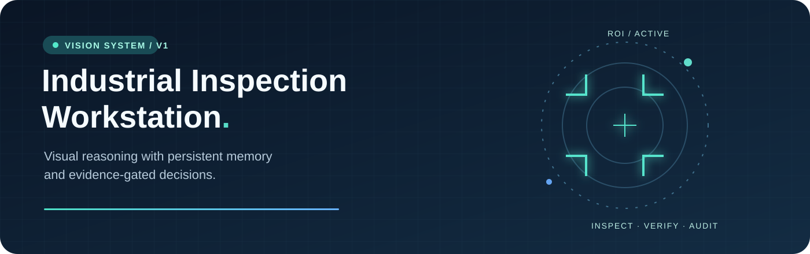
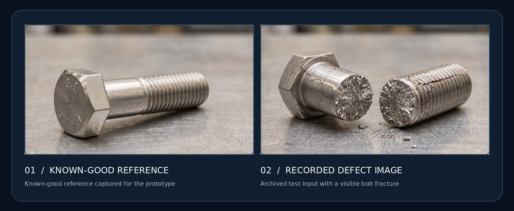
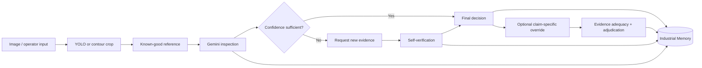

<div align="center">



<br />

**A vision-language inspection prototype that doesn't just classify an image — it asks for evidence, remembers decisions, and records why they changed.**

<br />


<br />

[**Explore the pipeline**](#-how-it-works) · [**Get started**](#-quick-start) · [**Understand the architecture**](docs/ARCHITECTURE.md) · [**Validation**](docs/VALIDATION.md)

</div>

---

## ✦ The idea

A single image can be misleading. Lighting can resemble a crack. A hidden thread can look undamaged. A model can be confident for the wrong reason.

**Industrial Inspection Workstation** treats an inspection as an *evidence-backed decision*, not merely a label. An operator teaches a known-good part, submits a new image, receives a structured assessment, and can provide additional views when confidence is low. If an operator disputes an outcome, a separate gate checks whether the new evidence actually addresses the model's original claim.

The system also retains batch-scoped episodes, image/rationale embeddings, drift signals, and an audit history.

<table>
<tr><td width="50%"><b>01 / Visual inspection</b><br/>Reference-conditioned image analysis with <code>ACCEPT</code>, <code>REJECT</code>, or <code>INDETERMINATE</code> outcomes.</td><td width="50%"><b>02 / Self-verification</b><br/>Low-confidence decisions request an additional view instead of silently forcing a binary answer.</td></tr>
<tr><td><b>03 / Industrial memory</b><br/>Append-only episodes, SHA-256 image integrity, production batches, and visual/semantic drift metrics.</td><td><b>04 / Evidence-gated overrides</b><br/>The original claim is reconsidered only with adequate new evidence and a sufficiently confident refutation.</td></tr>
</table>

## ◇ Sample inspection imagery



<div align="center"><sub>Illustrative images supplied with the original project. These are example inputs, not measured predictions or an accuracy benchmark.</sub></div>

<details>
<summary><b>View more example surfaces and components</b></summary>
<br />
<table>
<tr>
<td width="33%"><br/><sub>Steel finish</sub></td>
<td width="33%"><br/><sub>Dark steel</sub></td>
<td width="33%"><br/><sub>Weathered surface</sub></td>
</tr>
</table>
</details>

## ↗ Recorded inspection snapshots

The supplied archive included two actual saved inference episodes. Here are their **model-reported outputs**, not reconstructed or estimated performance figures:

| Archived sample | Assessment | Reported confidence | Visual drift | Semantic drift | Memory state |
| --- | --- | ---: | ---: | ---: | --- |
| [Corroded bolt](assets/samples/corroded-bolt.jpg) | `REJECT` | **95 / 100** | `0.174` | `0.447` | `DISAGREEMENT` |
| [Fractured bolt](assets/samples/fractured-bolt.jpg) | `REJECT` | **100 / 100** | `0.192` | `0.496` | `DISAGREEMENT` |

**Why the disagreement?** Semantic drift crossed its prototype threshold while visual drift did not. That is a memory diagnostic, *not* evidence that either classification is wrong. Two recorded cases cannot establish accuracy. [Examine the original recorded rationales and metrics →](docs/RECORDED_RUNS.md)

## ⌁ How it works



The model outputs structured evidence, an uncertainty explanation, a confidence score, and a suggested operator action. A low-confidence result triggers the self-verification route rather than being treated as a final answer.

### The override is not a second opinion button

```text
Original rationale → explicit claim
         │
         ▼
     New evidence?
         ├─ no / identical ──────────→ keep decision
         ▼
  Addresses original claim?
         ├─ no / inadequate ─────────→ keep decision
         ▼
   Claim adjudication
         ├─ SUPPORT / INSUFFICIENT ──→ keep decision
         └─ REFUTE (confidence ≥ 80) → change decision + audit
```

A separate adequacy gate requires confidence **≥ 70**. These are configured prototype thresholds, not validated production safety limits. See the [technical architecture](docs/ARCHITECTURE.md).

## ⚡ Quick start

**Prerequisites:** Python 3.10+, a Gemini API key for live inference, and an internet connection for API requests. The supplied YOLOv8n weights are local. You can run the offline tests without a key. The two model identifiers have been checked against the [Gemini model documentation](https://ai.google.dev/gemini-api/docs/models).

**1. Clone and install**

```bash
git clone https://github.com/YOUR_USERNAME/industrial-inspection-workstation.git
cd industrial-inspection-workstation
python -m venv .venv
# macOS/Linux: source .venv/bin/activate
# Windows PowerShell: .\.venv\Scripts\Activate.ps1
pip install -r requirements.txt
```

**2. Configure credentials**

```bash
cp .env.example .env
# On Windows PowerShell: Copy-Item .env.example .env
```

Set your **own** `GEMINI_API_KEY` inside `.env`. Do not commit it. The VLM and embedding model identifiers are configurable in the same file, since access and model availability can vary by account.

**3. Validate and launch**

```bash
python check_setup.py
python app.py
```

The NiceGUI operator interface runs at **http://localhost:8880**.

<details>
<summary><b>Windows PowerShell commands</b></summary>

```powershell
py -m venv .venv
.\.venv\Scripts\Activate.ps1
pip install -r requirements.txt
Copy-Item .env.example .env
# Edit .env and enter your Gemini key
python check_setup.py
python app.py
```
</details>

## ⌨ CLI walkthrough

Use `--no-yolo` to bypass generic object detection and run contour-based localization instead.

**Teach a known-good part**

```bash
python main.py teach --part bolt --image assets/samples/reference-bolt.jpg --no-yolo
```

**Inspect a sample**

```bash
python main.py inspect --part bolt --image assets/samples/fractured-bolt.jpg --query "Inspect fracture and threads" --no-yolo
```

**Inspect the active batch and memory status**

```bash
python main.py memory-status --part bolt
python main.py new-batch --part bolt --label "Shift B / Lot 14"
```

**Supply follow-up evidence** (use the returned inspection ID)

```bash
python main.py continue --inspection-id YOUR_INSPECTION_ID --image path/to/new-angle.jpg --no-yolo
```

**Request an evidence-gated override**

```bash
python main.py override --inspection-id YOUR_INSPECTION_ID --operator operator_01 \
  --justification "New close-up contradicts the original crack claim" \
  --image path/to/new-angle.jpg --no-yolo
```

> An override requires genuinely relevant evidence; it is not a guarantee that an original decision will change. Paths in the examples are illustrative where indicated.

## ▦ Repository map

```text
industrial-inspection-workstation/
├── app.py                          # NiceGUI web interface
├── main.py                         # CLI inspection workflows
├── check_setup.py                  # Local dependency + credential check
├── industrial_inspection/          # Core inspection package
│   ├── vision_localizer.py         # YOLO / contour ROI
│   ├── vlm_client.py               # Gemini structured output
│   ├── embedding_client.py         # Image + rationale embeddings
│   ├── learn_engine.py             # Teach known-good references
│   ├── inspection_engine.py        # Reference comparison
│   ├── self_verifying_inspection.py # Evidence feedback loop
│   ├── evidence_gated_decision.py  # Claim adjudication
│   ├── industrial_memory.py        # Episodes, batches, drift
│   └── decision_engine.py          # Orchestration
├── assets/
│   ├── branding/                   # README visual assets
│   └── samples/                    # Example component photos
├── models/yolov8n.pt               # Generic ROI detection weights
├── examples/                       # Sanitized saved inspection results
├── docs/                           # Architecture and validation details
├── tests/run_mock_tests.py         # API-free deterministic validation
├── .github/workflows/ci.yml        # Automated offline test job
├── .env.example                    # Credential template (safe to commit)
└── requirements.txt
```

Local inspection state (`industrial_memory.json`, `reference_images/`, `memory_archive/`, `runtime/`) is created on demand and excluded from Git; **sample imagery is deliberately separate from operator data**.

## ✓ Validation

```bash
python -m compileall -q app.py main.py check_setup.py industrial_inspection tests
python tests/run_mock_tests.py
```

The offline test harness mocks Gemini calls and verifies persistence, hashes, drift/concordance, and override gates. It makes **no remote calls**. The included GitHub Actions workflow runs these tests on push and pull request.

**Interpretation matters:** these are workflow and logic tests, not an accuracy evaluation of a deployed defect classifier. The supplied archive contained two saved inspection episodes but no reproducible comparative benchmark or calibration dataset, so no accuracy, precision, or speed claims are made here. Read [validation details](docs/VALIDATION.md).

## ⚙ Configuration & caveats

| Setting | Default | Meaning |
| --- | --- | --- |
| `GEMINI_MODEL` | `gemini-3.5-flash-lite` | Structured VLM inspection model; must be accessible to your API key |
| `GEMINI_EMBEDDING_MODEL` | `gemini-embedding-2` | Multimodal image/text embedding model |
| `VISUAL_DRIFT_THRESHOLD` | `0.25` | Prototype visual drift trigger (in `industrial_memory.py`) |
| `SEMANTIC_DRIFT_THRESHOLD` | `0.25` | Prototype rationale drift trigger |
| `CROSS_MODAL_CONCORDANCE_THRESHOLD` | `0.35` | Prototype image/rationale concordance threshold |
| `EVIDENCE_ADEQUACY_CONFIDENCE_THRESHOLD` | `70` | Minimum confidence to assess a challenge |
| `ADJUDICATION_CONFIDENCE_THRESHOLD` | `80` | Minimum confidence to flip an existing claim on `REFUTE` |

- **YOLOv8n is generic**, not trained for industrial defect detection. Contour localization is often preferable for these sample bolts.
- **Not production-qualified.** Thresholds, confidence numbers, model outputs and failure modes require calibration on real part families and lighting conditions. A model-provided confidence is not a calibrated statistical probability.
- **Privacy.** The Gemini API receives supplied images and text. Only use imagery permitted by your organization's data policy.
- **Audit model.** Local SHA-256 checks provide integrity checks for stored records; they do not make an append-only JSON file tamper-proof.
- **Memory reset.** `python main.py wipe-memory --confirm WIPE` deletes taught references, logs, and archives. Treat this as destructive.
- **Model availability.** Model identifiers provided by the original implementation are retained as defaults, but may need to be changed for your account. `python check_setup.py --api` makes optional live calls.

---

<div align="center">

<b>INSPECT  ·  VERIFY  ·  REMEMBER</b>

<sub>Research / engineering prototype • Built for transparent, evidence-aware visual inspection</sub>

</div>
