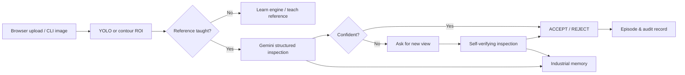
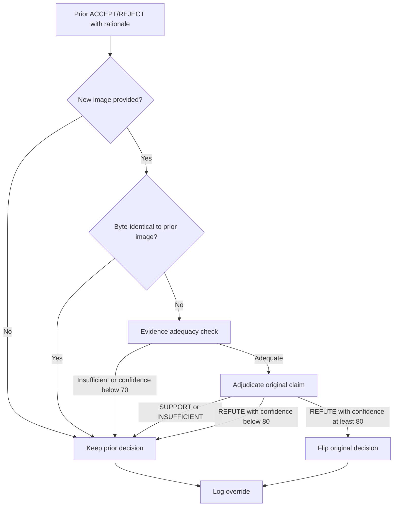

# Architecture notes

The public repository is split into a web application, a command-line harness, and a Python package holding the inspection modules. The original engine logic is retained and organized into a package to make its dependencies explicit.

## Inspection path

## Five memory layers

| Layer | Responsibility |
| --- | --- |
| Reference / semantic | Stored known-good images and descriptions for each part |
| Episodic | Append-only inspection records and image copies with integrity hashes |
| Batch scope | Baselines segmented by production batch |
| Drift / embedding | Visual and rationale vectors, cosine-based drift and concordance states |
| Audit | Explainability and operator override history |

Data are JSON-backed, with image copies kept in `memory_archive/`. They are local runtime artifacts, excluded from version control, and generated by the application as needed. This is a prototype persistence layer, **not** tamper-proof secure storage or a production database.

## Override path

The override is claim-specific rather than a silent second pass. Note that changing image bytes does not prove a new physical viewpoint; adequacy is assessed by the VLM and remains fallible.

## Module map

| Module | Role |
| --- | --- |
| `app.py` | NiceGUI operator interface |
| `main.py` | CLI routes for teach/inspect/continue/override/batches |
| `industrial_inspection/vision_localizer.py` | Optional YOLO, contour crop fallback |
| `industrial_inspection/learn_engine.py` | Taught known-good part descriptions |
| `industrial_inspection/inspection_engine.py` | Reference-conditioned inspection |
| `industrial_inspection/self_verifying_inspection.py` | Evidence request and recheck |
| `industrial_inspection/evidence_gated_decision.py` | Adequacy and claim adjudication |
| `industrial_inspection/industrial_memory.py` | JSON episode store and drift analytics |
| `industrial_inspection/embedding_client.py` | Gemini multimodal embedding adapter |
| `industrial_inspection/vlm_client.py` | Structured Gemini response adapter |

## Design limitations

- Default thresholds (`0.25` visual drift, `0.25` semantic drift, `0.35` concordance) are demonstration values, not industrial acceptance criteria.
- The bundled `yolov8n.pt` is an unmodified generic YOLOv8n model, not a bolt-specific trained defect detector. If it does not localize the component, contour cropping is used.
- A JSON file plus a hash is useful for traceability but not equivalent to a cryptographically protected external audit log.
- Low-confidence and new-evidence workflows call a remote model, incurring latency, costs, and the need to protect inspection imagery.
